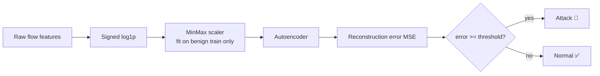
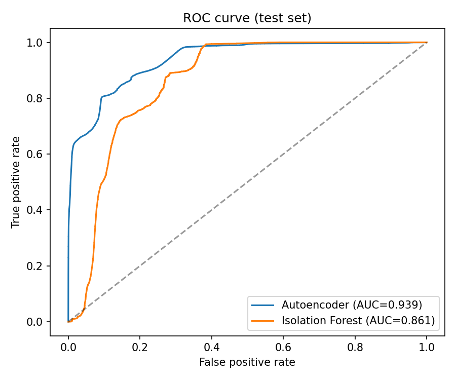
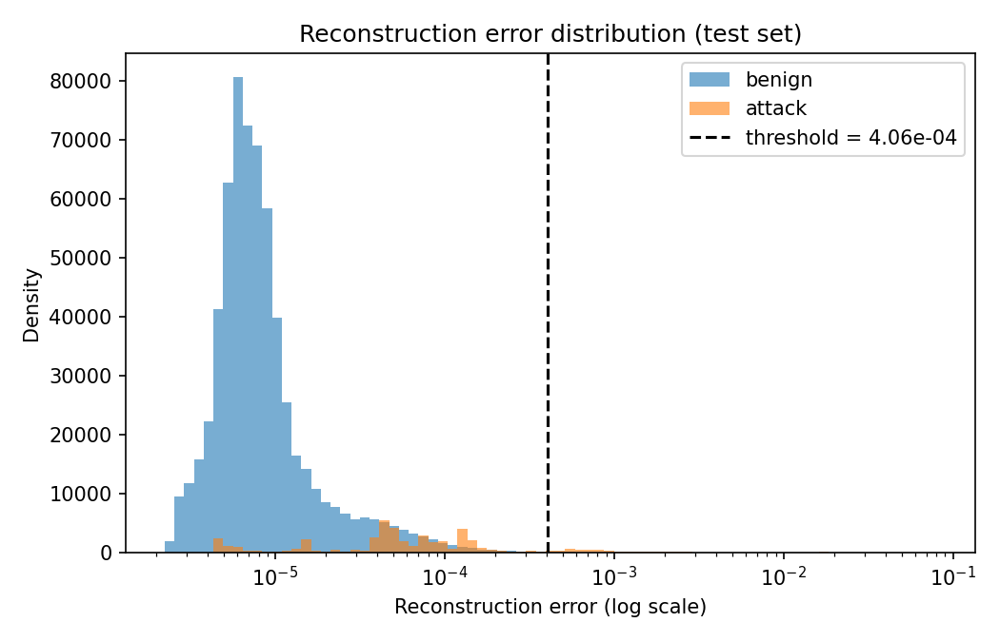

# 🛡️ AI-Powered Intrusion Detection System (IDS)


An unsupervised network intrusion detection system built around a PyTorch **autoencoder**. It was developed as a complementary study during an immersion internship at **Algérie Télécom**, exploring proactive security for modern telecom infrastructures (e.g. FTTH networks).

<!-- Add your live demo link here -->
<!-- **Live demo:** https://your-demo-url -->

## 🧠 How it works



1. The autoencoder is trained **only on benign traffic**, so it learns what "normal" looks like.
2. Anomalous flows are reconstructed poorly, which produces a high **mean squared error**.
3. The alert threshold is **calibrated on a separate validation set** (best F1), never on the test set.

## 🔬 Methodology

* **Dataset:** CICIDS2017 (78 flow features). After cleaning: 2,520,798 flows, about 83% benign and 17% attacks.
* **Cleaning:** inf/NaN rows and exact duplicates removed (duplicates would leak across splits).
* **Preprocessing:** signed `log1p` to tame heavy-tailed features, then MinMax scaling fitted on benign *training* rows only (no data leakage).
* **Splits:** stratified train / validation / test (60 / 20 / 20). The test set (504,160 flows) is used once, for the final evaluation.
* **Model:** fully connected autoencoder, 78 → 64 → 16 → 64 → 78, trained on benign flows only (up to 100 epochs, early stopping, best-validation checkpoint).
* **Threshold:** the value that maximizes F1 on the validation set (4.06e-4).
* **Baseline:** Isolation Forest, so the autoencoder is compared against something.

## 📊 Results (test set)

| Model            | ROC AUC | Precision | Recall | F1    | False positive rate |
|------------------|---------|-----------|--------|-------|---------------------|
| Autoencoder      | 0.939   | 0.890     | 0.637  | 0.742 | 1.6%                |
| Isolation Forest | 0.861   | -         | -      | -     | -                   |

| ROC curve | Error distribution |
|-----------|--------------------|
|  |  |

### Detection rate per attack type

| Attack type | Test flows | Detected |
|-------------|-----------:|---------:|
| DoS Hulk | 34,681 | 88.9% |
| DDoS | 25,632 | 83.1% |
| DoS slowloris | 1,101 | 61.1% |
| DoS GoldenEye | 1,968 | 33.8% |
| DoS Slowhttptest | 986 | 31.7% |
| Web Attack – Brute Force | 313 | 4.2% |
| Web Attack – XSS | 119 | 2.5% |
| Bot | 384 | 2.3% |
| PortScan | 18,186 | 2.0% |
| FTP-Patator | 1,129 | 0.9% |
| SSH-Patator | 635 | 0.0% |

Heartbleed (3 flows), Infiltration (6 flows) and Web Attack – SQL Injection (5 flows) are too rare in the test set to draw any conclusion.

**Takeaway:** the model is strong on volumetric attacks (DoS/DDoS) but almost blind to low-volume, protocol-conformant attacks (port scans, brute force, bots), because their individual flows look like benign traffic. PortScan alone accounts for more than half of the missed attacks. A single-flow reconstruction error cannot see these patterns; detecting them requires aggregating flows over time or using a supervised model.

## ⚠️ Limitations

* Reconstruction error is a *generic* anomaly signal: attacks that look statistically close to benign traffic are missed (see the per-attack table above).
* Evaluated on a single dataset with a random split. A temporal or cross-dataset split (e.g. CSE-CIC-IDS2018) would be a more realistic test.
* The demo scores 50 real held-out flows stored in `back-end/samples.json`; it is not a live packet-capture pipeline.

## 🚀 Features

* **Real-traffic demo:** the dashboard scores real held-out flows and reveals the ground truth, including misses and false alarms.
* **Typed REST API** (FastAPI) with single, batch and simulation endpoints.
* **Automated tests** (pytest).
* **Containerized** with Docker Compose, healthchecks and a non-root backend image.

## 🛠️ Tech stack

* **ML:** PyTorch, scikit-learn, pandas, Weights & Biases (optional)
* **Backend:** FastAPI, Uvicorn, Pydantic v2
* **Frontend:** React, Vite, Tailwind CSS, Framer Motion
* **DevOps:** Docker, Docker Compose

## 🐳 Getting started

```bash
git clone https://github.com/Djilali-77/AI-Powered-IDS.git
cd AI-Powered-IDS
docker compose up --build -d
```

* Dashboard: http://localhost:3000
* API docs (Swagger): http://localhost:8000/docs

Stop with `docker compose down`.

## 🔁 Retrain the model

```bash
python -m venv venv && source venv/bin/activate
pip install -r requirements-train.txt
python train_model.py --download      # needs ~/.kaggle/kaggle.json
# optional: --wandb, --epochs 100 --patience 8, --latent-dim 8
```

This regenerates `back-end/autoencoder.pth`, `scaler.pkl`, `model_config.json`, `samples.json` and the plots/metrics in `assets/`.

## 🔌 API

| Method | Endpoint | Description |
|--------|----------|-------------|
| GET | `/health` | Liveness check |
| GET | `/model-info` | Threshold, input size, test metrics |
| POST | `/predict` | Score one flow (raw features) |
| POST | `/predict/batch` | Score up to 1000 flows |
| GET | `/simulate/{benign\|attack}` | Score a random real test flow and return its ground truth |

## 🧪 Tests

```bash
cd back-end
pip install -r requirements-dev.txt
pytest
```

## 🗺️ Roadmap

* Aggregate flows over time windows to catch port scans and brute force
* Compare with a Variational Autoencoder and a supervised baseline
* Cross-dataset evaluation (CSE-CIC-IDS2018)
* Live flow extraction (CICFlowMeter) for near real-time scoring

## 📚 Dataset

Sharafaldin, I., Lashkari, A. H., Ghorbani, A. A. *Toward Generating a New Intrusion Detection Dataset and Intrusion Traffic Characterization*, ICISSP 2018.

## 📝 License

For academic and demonstration purposes.